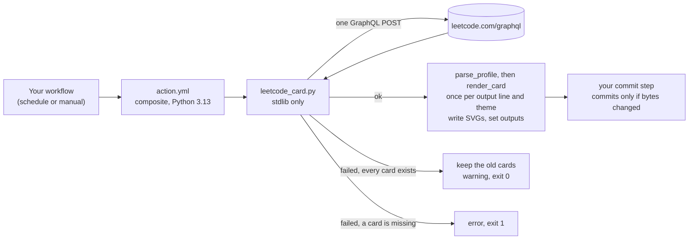

# LeetCode Card

[](https://github.com/Sagargupta16/leetcode-card-action/actions/workflows/ci.yml)
[](https://github.com/Sagargupta16/leetcode-card-action/releases/latest)
[](https://github.com/marketplace/actions/leetcode-card)
[](LICENSE)

Render your LeetCode contest rating as an animated SVG card that lives in your own repo.

<p align="center">
  
</p>

Your rating history draws itself in as a line with the peak marked, next to your badge, rating, top percentage, contest count, solved count and Easy/Medium/Hard progress bars. Turn on `heatmap` and a year of daily submissions sweeps in under it. Pick one of six themes, or have one run write a dark and a light card for a `<picture>` that follows the reader's GitHub theme. The previews are live data for [sagargupta1610](https://leetcode.com/u/sagargupta1610/), rendered 2026-10-18.

The card is a file in your repo, not an image served by a widget host, so there is no quota to run out and no third-party server to go down.

## Quick start

Create `.github/workflows/leetcode-card.yml`:

```yaml
name: LeetCode card

on:
  schedule:
    - cron: "30 6 * * *" # every day at 06:30 UTC
  workflow_dispatch:

permissions:
  contents: write

jobs:
  card:
    runs-on: ubuntu-latest
    steps:
      - uses: actions/checkout@v7

      - uses: Sagargupta16/leetcode-card-action@v1
        with:
          username: your-leetcode-username

      - name: Commit the card if it changed
        run: |
          git config user.name "github-actions[bot]"
          git config user.email "41898282+github-actions[bot]@users.noreply.github.com"
          git add assets/leetcode.svg
          if ! git diff --cached --quiet; then
            git commit -m "chore: update LeetCode card"
            git push
          fi
```

Run it once from the Actions tab to create the card. After that it refreshes every day, and commits only when the card changed.

## Embed

In your README:

```html
<a href="https://leetcode.com/u/your-leetcode-username/">
  
</a>
```

Or plain Markdown: ``

### Light and dark mode

Give `output` one line per card. A line can end in `?theme=<name>`, so one run and one fetch write a dark and a light card:

```yaml
      - uses: Sagargupta16/leetcode-card-action@v1
        with:
          username: your-leetcode-username
          theme: github-dark
          heatmap: true
          output: |
            assets/leetcode-dark.svg
            assets/leetcode-light.svg?theme=github-light
```

Commit both files (`git add assets/leetcode-dark.svg assets/leetcode-light.svg` in the commit step), then embed them with a `<picture>`. GitHub picks the source that matches the reader's theme:

```html
<a href="https://leetcode.com/u/your-leetcode-username/">
  <picture>
    <source media="(prefers-color-scheme: dark)" srcset="assets/leetcode-dark.svg" />
    
  </picture>
</a>
```

## Themes

Every theme runs through the same contrast gate as the default: text reaches 4.5:1 on the theme's background, and the rating line, the bars and every heatmap shade reach 3:1. Shown here with `heatmap: true`.

<p align="center">
  
  
  <br /><code>dark</code> (default) and <code>light</code>
</p>
<p align="center">
  
  
  <br /><code>github-dark</code> and <code>github-light</code>
</p>
<p align="center">
  
  
  <br /><code>dracula</code> and <code>nord</code>
</p>

`dark` and `light` share the amber accent; `github-dark` and `github-light` use GitHub's own blue and canvas colors. An `accent` you set overrides the theme's on every card the run writes.

## Inputs

| Input | Required | Default | Description |
|-------|----------|---------|-------------|
| `username` | Yes | - | Your LeetCode username, as in `leetcode.com/u/<username>` |
| `output` | No | `assets/leetcode.svg` | Where to write the SVG, relative to the repository root. One path per line writes one card per line from a single fetch; end a line with `?theme=<name>` to give that card its own theme |
| `theme` | No | `dark` | `dark`, `light`, `github-dark`, `github-light`, `dracula` or `nord`. Applies to every `output` line without its own `?theme=` |
| `heatmap` | No | `false` | `true` adds the past year of daily submissions under the card, with the year's submissions, active days and longest streak |
| `accent` | No | the theme's | Accent color as `#rgb` or `#rrggbb`: the rating line, the badge line, the heading and the heatmap. A color that does not reach 4.5:1 on the card keeps its hue and is lightened on dark themes or darkened on light ones until it does. `dark` uses `#f59e0b` |
| `title` | No | `LEETCODE CONTEST RATING \| {contests} CONTESTS` | Card heading. `{contests}` becomes the number of rated contests you attended |

If you change `output`, change the path in the commit step to match.

## Outputs

| Output | Description |
|--------|-------------|
| `rating` | Current contest rating, rounded. Empty if you have no rated contest yet |
| `badge` | Contest badge, such as `Knight` or `Guardian`. Empty if you have none |
| `solved` | Number of problems solved |
| `contests` | Number of rated contests attended |

All four are empty on a run where the fetch failed and the old card was kept.

## How it works

1. Sends one GraphQL query to `https://leetcode.com/graphql`, the public endpoint LeetCode's own profile pages read from. No token, no login, no secrets. The submission calendar is only asked for when `heatmap` is on.
2. Builds the card with the Python standard library. The SVG is self-contained: no scripts, no external fonts or images, CSS and SMIL animation only, so it renders inside GitHub's `` sandbox.
3. Writes one card per `output` line, each in its theme. The same numbers always produce the same bytes, so an unchanged profile leaves nothing to commit.
4. If LeetCode fails (network error, rate limit, an error or a changed shape in the response, a username that does not exist), the existing cards are kept, the run logs a warning and the step succeeds. If any card has nothing to keep yet, the step fails with the reason.

The card adapts to your profile:

- **Two or more rated contests:** the rating chart, with the peak ringed and labeled.
- **Fewer than two:** a shorter card without the chart, since a line needs two points. The badge line reads "No contests yet" when there are none.
- **No badge:** the badge line shows your rating instead.
- **`heatmap: true`:** the card grows by a GitHub-style grid of the past 53 weeks, one column per week with Sunday on top, ending today (UTC). Shades step on a log scale, so one very busy day does not wash every other day out.

### Flow



### Design decisions

- **Self-hosted, not a widget.** A hosted card is an image someone else's server builds and serves, with that server's uptime and rate limits. This one renders once a day in your Actions run and is served by GitHub like any other file in your repo.
- **Standard library only.** `action.yml` installs Python and nothing else, so there is no dependency to resolve, cache or break on a consumer's runner.
- **Deterministic output.** The same numbers give the same bytes, so the commit step only commits when your profile actually changed.
- **Fail soft.** LeetCode's API is unofficial. A bad day keeps yesterday's card instead of blanking your README.
- **Readable by default.** Every text color reaches WCAG 4.5:1 on the card, and the chart line, the difficulty bars and every heatmap shade reach 3:1, enforced by tests for every theme crossed with several accents. A custom `accent` that fails is lightened or darkened until it passes, and a theme's muted labels get just enough opacity to pass on that theme's background.
- **Themes are data.** A theme is four colors (background, ink, text, accent) in one dict; every other shade on the card is derived from them, so a new theme cannot skip the contrast gate.
- **Locked-down fetch.** Requests go only to `https://leetcode.com/`; every string from the API is HTML-escaped before it reaches the SVG, and the accent is regex-validated.

## Limits

- LeetCode's GraphQL API is unofficial and undocumented. It can change shape, rate-limit or block runners without notice. When it does, your last card stays up and the run warns.
- leetcode.com accounts only. leetcode.cn is a separate site with its own API.
- The numbers are as fresh as your schedule: daily with the Quick start workflow.
- With `heatmap: true` the grid moves forward every day, so expect one commit a day. Days are UTC, as LeetCode's own calendar counts them.
- The card is 840 px wide and scales down with the page, so on a phone its smallest labels get small.
- Fonts come from the viewer's system (JetBrains Mono or Consolas, Segoe UI or Inter or the system UI font), so text renders slightly differently across operating systems.
- The action writes the file and nothing else. Committing it is up to your workflow, as in the Quick start.

## Development

The script runs on its own, outside Actions:

```bash
LEETCODE_USERNAME=your-leetcode-username python leetcode_card.py
```

That writes `assets/leetcode.svg` (gitignored). `LEETCODE_THEME`, `LEETCODE_HEATMAP`, `LEETCODE_ACCENT` and `LEETCODE_TITLE` set the other inputs. To re-render every preview in this README from one live fetch:

```bash
python scripts/render_examples.py
```

Lint and tests, at the versions CI pins:

```bash
uvx ruff@0.17.1 check .
uv run --no-project --with pytest==9.1.1 pytest -v
```

The tests never touch the network. CI also runs `action.yml` itself against a live profile and fails if the SVG does not parse or any output is empty, then runs it again with `heatmap: true` and a `github-dark`/`github-light` pair and checks both cards. See [CONTRIBUTING.md](CONTRIBUTING.md) for the conventions.

## License

MIT. See [LICENSE](LICENSE).
